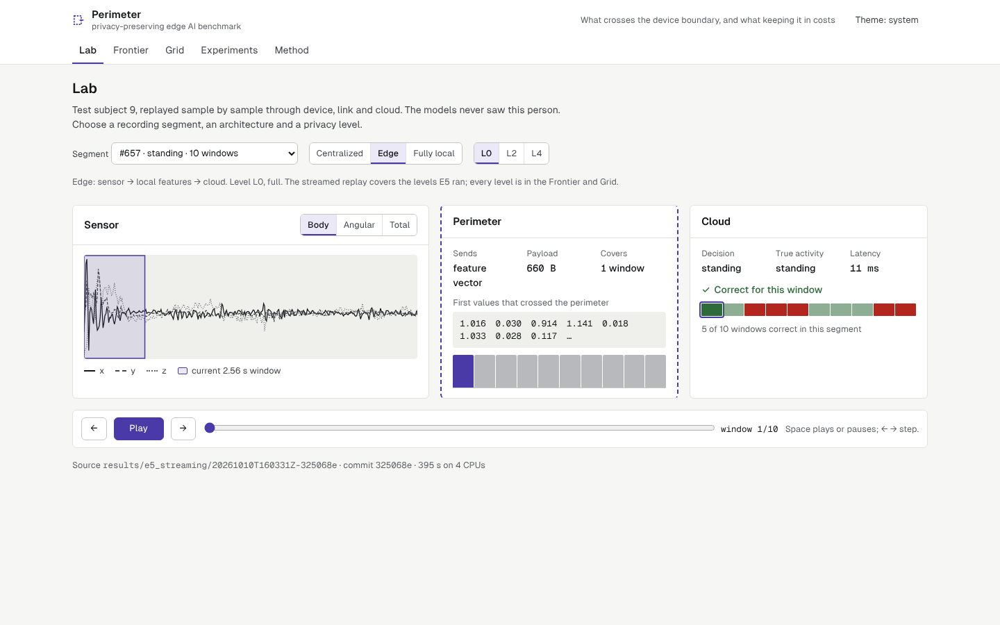
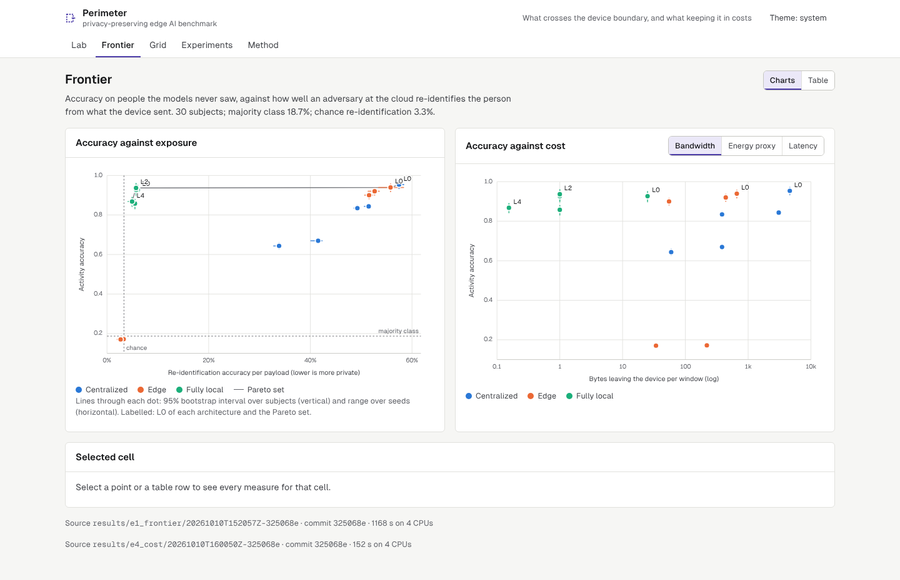
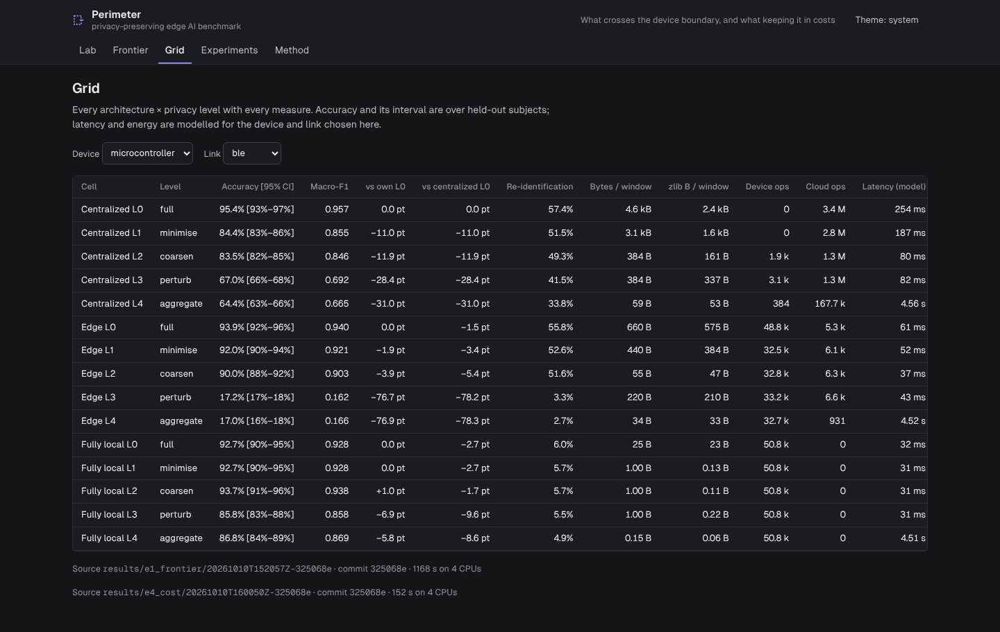
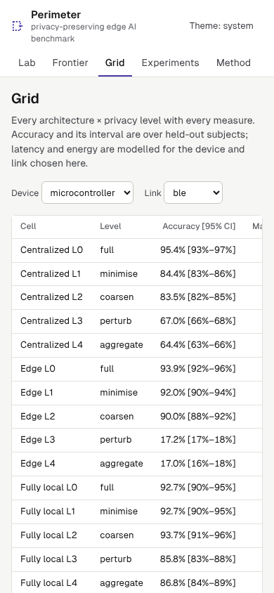

# Privacy-preserving edge AI benchmark

How much accuracy, privacy and compute does it cost to keep sensor data on the device? This
benchmark replays real smartphone inertial streams (UCI HAR, 30 people) through three
architectures and five graded privacy levels, and measures every cell on the same scales:

| Architecture | Data path | What leaves the device |
|---|---|---|
| Centralized | sensor → raw data → cloud → AI | raw sensor windows |
| Edge | sensor → local processing → features → cloud | a feature vector |
| Fully local | sensor → edge AI → decision | the activity label |

Every number below was produced by the code in this repository; the interpreted findings are in
[docs/REPORT.md](docs/REPORT.md) and the full generated tables in
[docs/generated/results.md](docs/generated/results.md).

## Results

| Cell | Accuracy on unseen people (95% CI) | Re-identification (chance 0.033) | Bytes / window |
|---|---:|---:|---:|
| Centralized L0 | 0.954 (0.934–0.971) | 0.574 | 4,608 |
| Edge L0 | 0.939 (0.918–0.958) | 0.558 | 660 |
| Edge L2 (4-bit features) | 0.900 (0.882–0.916) | 0.516 | 55 |
| Fully local L0 | 0.927 (0.898–0.950) | 0.060 | 25 |
| Fully local L2 (smoothed label) | 0.937 (0.909–0.960) | 0.057 | 1 |

- **Features identify people almost as well as raw signals.** Edge processing cuts bandwidth by 7×
  but re-identification only falls from 0.574 to 0.558. Sending labels is what protects identity.
- **Pareto set:** centralized L0, edge L0, fully local L2 and fully local L4. Fully local L2 is
  within 0.017 of the most accurate cell at near-chance exposure.
- **Local differential privacy works for labels, not features.** Randomised response keeps 0.856
  accuracy at ε = 4 and matches theory to within 0.003; Laplace noise on 165 features stays at the
  majority-class floor up to ε = 16.
- **Fully local is cheapest on the energy proxy** in every device and link profile except a
  microcontroller on Wi-Fi at the lowest radio-energy setting (modelled, not measured).
- **The streaming pipeline equals batch** for all six deterministic cells (2,947 windows each).
- The exposure ranking holds across 8 adversaries (Kendall τ 0.83–0.96).

## What is built

- `edgebench.data`: fetches the UCI HAR archive (SHA-256 pinned) and rebuilds 857 continuous
  recording segments from the overlapping windows, so the sensor stream can be replayed sample by
  sample.
- `edgebench.stream`: the device runtime (window buffer, on-device stage, L4 block buffer), a
  modelled uplink and the cloud receiver, driven on a simulated clock.
- `edgebench.privacy`: the five cumulative levels per architecture (minimise, coarsen, perturb with
  Gaussian noise / Laplace ε-LDP / randomised response, aggregate).
- `edgebench.rocket`, `edgebench.features`, `edgebench.bench`: the cloud models (random-kernel ridge
  for raw signals, gradient-boosted trees for features), the int8 on-device classifier and the
  re-identification adversaries.
- `edgebench.measure`: accuracy with subject-level bootstrap intervals, exposure, bytes, analytic
  operation counts, latency and energy models.
- `edgebench.experiments`: E1 frontier grid, E2 adversary strength, E3 ε sweep, E4 cost and
  break-even, E5 streaming replay. Each run writes `results/<exp>/<UTC>-<commit>/` with its config,
  provenance and data.
- **Perimeter** console (`web/`, React + TypeScript): a lab that replays a test subject through
  three lanes (sensor, what crosses the perimeter, cloud decision), the frontier charts, the full
  grid, experiment provenance and the method. Served read-only by FastAPI with security headers,
  an optional bearer token and rate limiting.

```
sensor replay ──► device runtime ──► privacy level ──► modelled link ──► cloud model ──► decision
 (50 Hz, UCI HAR)   (window, features,     (L0–L4)        (bytes, delay)     (raw / features)
                    or local classifier)                         │
                                                                 └──► re-identification adversary
```

## Quick start

Requires Python 3.11+ with [uv](https://docs.astral.sh/uv/), Node 22, and about 1 GB of disk.

```bash
make setup       # Python and console dependencies
make data        # download UCI HAR (61 MB) and verify its SHA-256
make benchmark   # E1-E5 on all 30 subjects (~45 min on 4 CPUs), then regenerate the tables and figures
make serve       # console and API on http://127.0.0.1:8000
```

`make smoke` runs every experiment on 8 subjects with tiny models in a few minutes (CI uses it; it
is never reported). `make test`, `make test-ui` (Playwright + axe-core) and `make lint` are the
checks; `make screenshots` recaptures the console. Copy `.env.example` to `.env` to set a host,
token or rate limit.

## Screenshots

| Lab | Frontier |
|---|---|
|  |  |
|  |  |

All 15 screenshots (light, dark, mobile) are in [docs/screenshots](docs/screenshots).

## Documentation

[PLAN](docs/PLAN.md) (scope, hypotheses, experiments) · [DESIGN](docs/DESIGN.md) (console) ·
[METRICS](docs/METRICS.md) (definitions) · [DECISIONS](docs/DECISIONS.md) (D1–D13) ·
[DATASET](data/DATASET.md) · [REPORT](docs/REPORT.md) · [REVIEW](docs/REVIEW.md)

## Limits

- Costs are modelled from exact operation counts and byte sizes with stated device and link
  constants; there is no physical device or radio measurement.
- Exposure is measured against one family of enrolled adversaries among 30 people; it is a lower
  bound for this population.
- ε is per payload; a session of payloads composes.
- One public dataset, one device position.

## Future work

Measure energy on real hardware (a microcontroller and a phone with a power monitor); add a
sequence-model adversary; per-session privacy budgets; repeat the randomised E5 cells over several
noise draws.

## Data and licence

Code: MIT ([LICENSE](LICENSE)). The UCI HAR dataset is not redistributed: it is downloaded on
demand, its terms forbid commercial use and require citing Anguita et al. (2013); see
[data/DATASET.md](data/DATASET.md). Citation metadata for this repository: [CITATION.cff](CITATION.cff).
