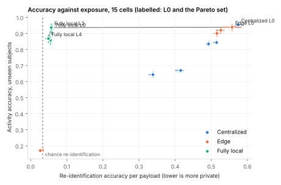
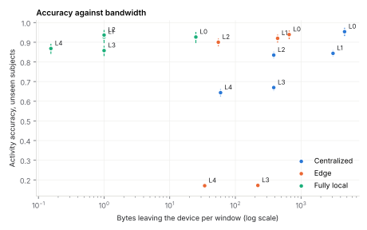
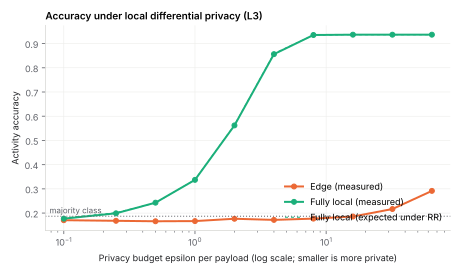
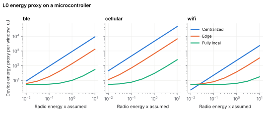
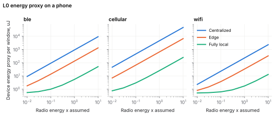

# Measured results

Generated by `edgebench report` from the latest run of each experiment. Every number below was produced by the code in this repository on the UCI HAR dataset; nothing was typed in by hand.

## E1 Frontier grid

**Question.** Where does each architecture and privacy level sit on accuracy, exposure and bandwidth?

**Findings.**

- Majority-class accuracy 0.187; chance re-identification 1/30 = 0.033.
- Pareto set (accuracy vs re-identification, with 'transmit nothing' as a competitor): centralized/L0, edge/L0, local/L2, local/L4; 'transmit nothing' itself is on it.
- Below the majority-class floor (upper CI bound): edge/L3, edge/L4.

*Every cell (accuracy: mean over subjects and seeds, 95% bootstrap CI over subjects; exposure: re-identification accuracy per payload, mean and range over seeds)*

| Cell | Level | Accuracy | CI low | CI high | vs centralized L0 | Re-identification | Re-id per segment | Bytes / window | Pareto |
|---|---|---:|---:|---:|---:|---:|---:|---:|---|
| centralized/L0 | full | 0.954 | 0.934 | 0.971 | 0.000 | 0.574 | 0.678 | 4,608.0 | yes |
| centralized/L1 | minimise | 0.844 | 0.831 | 0.857 | -0.110 | 0.515 | 0.654 | 3,072.0 |  |
| centralized/L2 | coarsen | 0.835 | 0.821 | 0.849 | -0.119 | 0.493 | 0.625 | 384.0 |  |
| centralized/L3 | perturb | 0.670 | 0.656 | 0.682 | -0.284 | 0.415 | 0.557 | 384.0 |  |
| centralized/L4 | aggregate | 0.644 | 0.628 | 0.659 | -0.310 | 0.338 | 0.410 | 59.453 |  |
| edge/L0 | full | 0.939 | 0.918 | 0.958 | -0.015 | 0.558 | 0.669 | 660.0 | yes |
| edge/L1 | minimise | 0.920 | 0.901 | 0.937 | -0.034 | 0.526 | 0.723 | 440.0 |  |
| edge/L2 | coarsen | 0.900 | 0.882 | 0.916 | -0.054 | 0.516 | 0.718 | 55.000 |  |
| edge/L3 | perturb | 0.172 | 0.167 | 0.177 | -0.782 | 0.033 | 0.031 | 220.0 |  |
| edge/L4 | aggregate | 0.170 | 0.158 | 0.182 | -0.783 | 0.027 | 0.023 | 34.062 |  |
| local/L0 | full | 0.927 | 0.898 | 0.950 | -0.027 | 0.060 | 0.054 | 25.000 |  |
| local/L1 | minimise | 0.927 | 0.898 | 0.950 | -0.027 | 0.057 | 0.052 | 1.000 |  |
| local/L2 | coarsen | 0.937 | 0.909 | 0.960 | -0.017 | 0.057 | 0.052 | 1.000 | yes |
| local/L3 | perturb | 0.858 | 0.832 | 0.879 | -0.096 | 0.055 | 0.052 | 1.000 |  |
| local/L4 | aggregate | 0.868 | 0.843 | 0.890 | -0.086 | 0.049 | 0.045 | 0.155 | yes |

Run `20261010T152057Z-325068e`, commit `325068e`, 1168 s on 4 CPUs, subjects: all 30.

## E2 Adversary strength

**Question.** Does the ordering of cells by exposure hold for weaker and stronger adversaries?

**Findings.**

- Kendall tau of the exposure ranking against the reference adversary (strong, 50% enrolment): 0.83 to 0.96 across 7 other adversaries.

*Re-identification accuracy per payload, by adversary*

| Adversary | Kendall tau vs reference | centralized/L0 | centralized/L1 | centralized/L2 | centralized/L3 | centralized/L4 | edge/L0 | edge/L1 | edge/L2 | edge/L3 | edge/L4 | local/L0 | local/L1 | local/L2 | local/L3 | local/L4 |
|---|---:|---:|---:|---:|---:|---:|---:|---:|---:|---:|---:|---:|---:|---:|---:|---:|
| linear, enrol 10% | 0.880 | 0.416 | 0.366 | 0.336 | 0.251 | 0.230 | 0.355 | 0.324 | 0.314 | 0.036 | 0.032 | 0.047 | 0.048 | 0.048 | 0.045 | 0.042 |
| strong, enrol 10% | 0.900 | 0.471 | 0.454 | 0.424 | 0.351 | 0.283 | 0.417 | 0.399 | 0.398 | 0.034 | 0.034 | 0.048 | 0.048 | 0.048 | 0.045 | 0.041 |
| linear, enrol 30% | 0.829 | 0.474 | 0.426 | 0.402 | 0.286 | 0.239 | 0.392 | 0.361 | 0.351 | 0.033 | 0.034 | 0.049 | 0.046 | 0.045 | 0.043 | 0.046 |
| strong, enrol 30% | 0.848 | 0.511 | 0.458 | 0.448 | 0.373 | 0.278 | 0.457 | 0.425 | 0.421 | 0.034 | 0.034 | 0.048 | 0.046 | 0.045 | 0.043 | 0.049 |
| linear, enrol 50% | 0.905 | 0.532 | 0.482 | 0.453 | 0.314 | 0.291 | 0.472 | 0.421 | 0.408 | 0.035 | 0.040 | 0.060 | 0.055 | 0.055 | 0.052 | 0.042 |
| strong, enrol 50% | 1.000 | 0.569 | 0.519 | 0.496 | 0.423 | 0.343 | 0.534 | 0.530 | 0.517 | 0.036 | 0.020 | 0.059 | 0.055 | 0.055 | 0.052 | 0.042 |
| linear, enrol 70% | 0.943 | 0.563 | 0.518 | 0.490 | 0.331 | 0.304 | 0.527 | 0.477 | 0.458 | 0.039 | 0.016 | 0.063 | 0.049 | 0.049 | 0.045 | 0.041 |
| strong, enrol 70% | 0.962 | 0.624 | 0.564 | 0.551 | 0.472 | 0.405 | 0.659 | 0.602 | 0.571 | 0.035 | 0.023 | 0.062 | 0.049 | 0.049 | 0.046 | 0.041 |

Run `20261010T154024Z-325068e`, commit `325068e`, 477 s on 4 CPUs, subjects: all 30.

## E3 Local differential privacy

**Question.** How fast does accuracy fall as epsilon shrinks, for features and for labels?

**Findings.**

- edge: accuracy 0.171 at epsilon 0.1, 0.292 at epsilon 64.
- local: accuracy 0.177 at epsilon 0.1, 0.937 at epsilon 64.

*Accuracy (mean and sd over folds) and re-identification per payload, by epsilon per payload*

| Epsilon | Architecture | Accuracy | sd | Expected (randomised response) | Re-identification |
|---:|---|---:|---:|---:|---:|
| 0.100 | edge | 0.171 | 0.005 |  | 0.039 |
| 0.100 | local | 0.177 | 0.008 | 0.180 | 0.040 |
| 0.250 | edge | 0.168 | 0.009 |  | 0.035 |
| 0.250 | local | 0.199 | 0.006 | 0.201 | 0.040 |
| 0.500 | edge | 0.166 | 0.007 |  | 0.037 |
| 0.500 | local | 0.243 | 0.010 | 0.242 | 0.041 |
| 1 | edge | 0.167 | 0.003 |  | 0.037 |
| 1 | local | 0.337 | 0.008 | 0.338 | 0.037 |
| 2 | edge | 0.177 | 0.007 |  | 0.037 |
| 2 | local | 0.562 | 0.010 | 0.564 | 0.042 |
| 4 | edge | 0.172 | 0.011 |  | 0.036 |
| 4 | local | 0.856 | 0.028 | 0.859 | 0.052 |
| 8 | edge | 0.177 | 0.006 |  | 0.036 |
| 8 | local | 0.935 | 0.032 | 0.935 | 0.055 |
| 16 | edge | 0.186 | 0.009 |  | 0.035 |
| 16 | local | 0.937 | 0.032 | 0.937 | 0.055 |
| 32 | edge | 0.217 | 0.011 |  | 0.036 |
| 32 | local | 0.937 | 0.032 | 0.937 | 0.055 |
| 64 | edge | 0.292 | 0.011 |  | 0.042 |
| 64 | local | 0.937 | 0.032 | 0.937 | 0.055 |

- Epsilon is per payload (one window, or one block at L4). A person sends one payload every 1.28 s, so over time the guarantee composes: k payloads give k x epsilon.

Run `20261010T155344Z-325068e`, commit `325068e`, 419 s on 4 CPUs, subjects: all 30.

## E4 Cost

**Question.** What does each cell cost in bandwidth, computation, latency and energy, and when is fully local cheapest?

**Findings.**

- Fully local is not cheapest on energy for: microcontroller over wifi (at some radio factors).

*Per window: bytes on the wire, operations (analytic) and single-window wall time (measured here)*

| Cell | Bytes / window | zlib bytes / window | Uplink bit/s | Device ops | Cloud ops | Device ms (here) | Cloud ms (here) | Block wait s |
|---|---:|---:|---:|---:|---:|---:|---:|---:|
| centralized/L0 | 4,608.0 | 2,386.8 | 28,800.0 | 0.000 | 3.41e+06 | 0.005 | 40.157 | 0.000 |
| centralized/L1 | 3,072.0 | 1,592.5 | 19,200.0 | 0.000 | 2.75e+06 | 0.008 | 33.753 | 0.000 |
| centralized/L2 | 384.0 | 160.6 | 2,400.0 | 1,920.0 | 1.34e+06 | 0.036 | 34.822 | 0.000 |
| centralized/L3 | 384.0 | 336.7 | 2,400.0 | 3,072.0 | 1.34e+06 | 0.048 | 36.283 | 0.000 |
| centralized/L4 | 59.760 | 52.964 | 373.5 | 384.0 | 1.68e+05 | 0.048 | 33.620 | 4.480 |
| edge/L0 | 660.0 | 574.6 | 4,125.0 | 48,768.0 | 5,338.0 | 0.496 | 4.007 | 0.000 |
| edge/L1 | 440.0 | 383.8 | 2,750.0 | 32,512.0 | 6,132.0 | 0.436 | 3.972 | 0.000 |
| edge/L2 | 55.000 | 47.076 | 343.8 | 32,842.0 | 6,349.0 | 0.482 | 4.259 | 0.000 |
| edge/L3 | 220.0 | 209.9 | 1,375.0 | 33,172.0 | 6,571.0 | 0.428 | 3.706 | 0.000 |
| edge/L4 | 34.237 | 32.694 | 214.0 | 32,704.5 | 931.1 | 0.434 | 3.853 | 4.480 |
| local/L0 | 25.000 | 23.235 | 156.2 | 50,766.0 | 0.000 | 0.631 | 0.000 | 0.000 |
| local/L1 | 1.000 | 0.129 | 6.250 | 50,766.0 | 0.000 | 0.603 | 0.000 | 0.000 |
| local/L2 | 1.000 | 0.109 | 6.250 | 50,774.0 | 0.000 | 0.617 | 0.000 | 0.000 |
| local/L3 | 1.000 | 0.216 | 6.250 | 50,778.0 | 0.000 | 0.588 | 0.000 | 0.000 |
| local/L4 | 0.156 | 0.059 | 0.973 | 50,778.0 | 0.000 | 0.613 | 0.000 | 4.480 |

*Cheapest L0 architecture on device energy as radio energy per byte is scaled*

| Device | Link | Radio x | Centralized uJ | Edge uJ | Local uJ | Cheapest |
|---|---|---:|---:|---:|---:|---|
| microcontroller | ble | 0.010 | 9.216 | 6.197 | 5.127 | local |
| microcontroller | ble | 0.030 | 27.648 | 8.837 | 5.227 | local |
| microcontroller | ble | 0.100 | 92.160 | 18.077 | 5.577 | local |
| microcontroller | ble | 0.300 | 276.5 | 44.477 | 6.577 | local |
| microcontroller | ble | 1 | 921.6 | 136.9 | 10.077 | local |
| microcontroller | ble | 3 | 2,764.8 | 400.9 | 20.077 | local |
| microcontroller | ble | 10 | 9,216.0 | 1,324.9 | 55.077 | local |
| microcontroller | wifi | 0.010 | 2.304 | 5.207 | 5.089 | centralized |
| microcontroller | wifi | 0.030 | 6.912 | 5.867 | 5.114 | local |
| microcontroller | wifi | 0.100 | 23.040 | 8.177 | 5.202 | local |
| microcontroller | wifi | 0.300 | 69.120 | 14.777 | 5.452 | local |
| microcontroller | wifi | 1 | 230.4 | 37.877 | 6.327 | local |
| microcontroller | wifi | 3 | 691.2 | 103.9 | 8.827 | local |
| microcontroller | wifi | 10 | 2,304.0 | 334.9 | 17.577 | local |
| microcontroller | cellular | 0.010 | 46.080 | 11.477 | 5.327 | local |
| microcontroller | cellular | 0.030 | 138.2 | 24.677 | 5.827 | local |
| microcontroller | cellular | 0.100 | 460.8 | 70.877 | 7.577 | local |
| microcontroller | cellular | 0.300 | 1,382.4 | 202.9 | 12.577 | local |
| microcontroller | cellular | 1 | 4,608.0 | 664.9 | 30.077 | local |
| microcontroller | cellular | 3 | 13,824.0 | 1,984.9 | 80.077 | local |
| microcontroller | cellular | 10 | 46,080.0 | 6,604.9 | 255.1 | local |
| phone | ble | 0.010 | 9.216 | 1.808 | 0.558 | local |
| phone | ble | 0.030 | 27.648 | 4.448 | 0.658 | local |
| phone | ble | 0.100 | 92.160 | 13.688 | 1.008 | local |
| phone | ble | 0.300 | 276.5 | 40.088 | 2.008 | local |
| phone | ble | 1 | 921.6 | 132.5 | 5.508 | local |
| phone | ble | 3 | 2,764.8 | 396.5 | 15.508 | local |
| phone | ble | 10 | 9,216.0 | 1,320.5 | 50.508 | local |
| phone | wifi | 0.010 | 2.304 | 0.818 | 0.520 | local |
| phone | wifi | 0.030 | 6.912 | 1.478 | 0.545 | local |
| phone | wifi | 0.100 | 23.040 | 3.788 | 0.633 | local |
| phone | wifi | 0.300 | 69.120 | 10.388 | 0.883 | local |
| phone | wifi | 1 | 230.4 | 33.488 | 1.758 | local |
| phone | wifi | 3 | 691.2 | 99.488 | 4.258 | local |
| phone | wifi | 10 | 2,304.0 | 330.5 | 13.008 | local |
| phone | cellular | 0.010 | 46.080 | 7.088 | 0.758 | local |
| phone | cellular | 0.030 | 138.2 | 20.288 | 1.258 | local |
| phone | cellular | 0.100 | 460.8 | 66.488 | 3.008 | local |
| phone | cellular | 0.300 | 1,382.4 | 198.5 | 8.008 | local |
| phone | cellular | 1 | 4,608.0 | 660.5 | 25.508 | local |
| phone | cellular | 3 | 13,824.0 | 1,980.5 | 75.508 | local |
| phone | cellular | 10 | 46,080.0 | 6,600.5 | 250.5 | local |

- Device ops/s, energy per operation and radio energy per byte are stated assumptions (configs/e4_cost.yaml), not measurements. Wall times were measured on this machine and are shown for scale only.

Run `20261010T160050Z-325068e`, commit `325068e`, 152 s on 4 CPUs, subjects: all 30.

The full modelled latency and energy table (every cell, device and link) is in the run's `modelled.json`.

## E5 Streaming replay

**Question.** Do decisions made sample by sample through device, link and cloud equal the batch decisions?

**Findings.**

- 6/6 deterministic cells streamed exactly the batch decisions.

*Streamed against batch decisions for the 9 test subjects*

| Cell | Windows (batch) | Windows (streamed) | Same decision | Accuracy batch | Accuracy streamed | Median latency s | p95 latency s |
|---|---:|---:|---:|---:|---:|---:|---:|
| centralized/L0 | 2,947 | 2,947 | 1.000 | 0.957 | 0.957 | 0.014 | 0.014 |
| centralized/L2 | 2,947 | 2,947 | 1.000 | 0.873 | 0.873 | 0.010 | 0.010 |
| centralized/L4 | 2,947 | 2,947 | 0.647 | 0.695 | 0.637 | 3.850 | 8.970 |
| edge/L0 | 2,947 | 2,947 | 1.000 | 0.932 | 0.932 | 0.011 | 0.011 |
| edge/L2 | 2,947 | 2,947 | 1.000 | 0.904 | 0.904 | 0.010 | 0.010 |
| edge/L4 | 2,947 | 2,947 | 0.159 | 0.172 | 0.096 | 3.850 | 8.970 |
| local/L0 | 2,947 | 2,947 | 1.000 | 0.930 | 0.930 | 0.010 | 0.010 |
| local/L2 | 2,947 | 2,947 | 1.000 | 0.944 | 0.944 | 0.010 | 0.010 |
| local/L4 | 2,947 | 2,947 | 0.842 | 0.882 | 0.874 | 3.850 | 8.970 |

- Latency uses the modelled link 'wifi' and the cloud's measured compute is not included here (see E4).

Run `20261010T160331Z-325068e`, commit `325068e`, 395 s on 4 CPUs, subjects: all 30.
